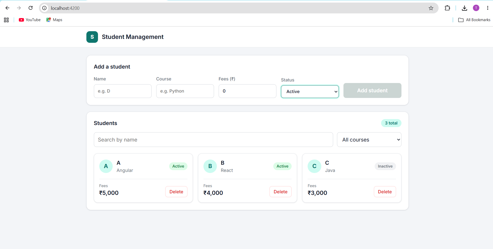
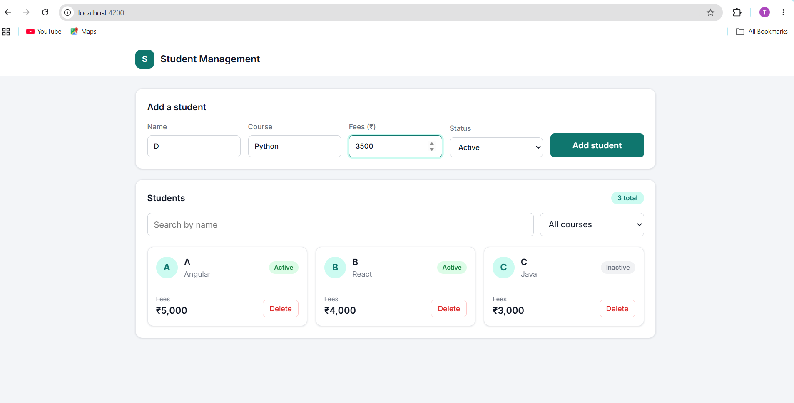
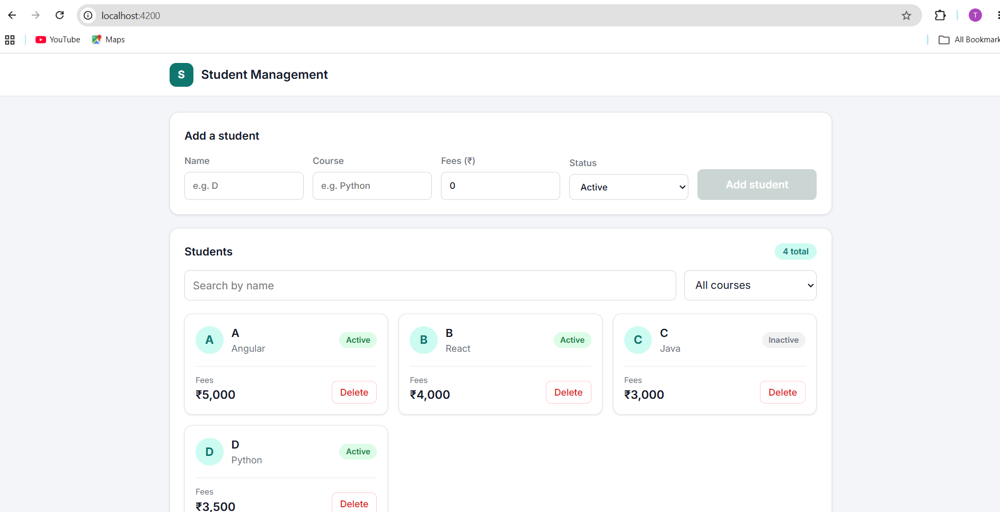

# Student Management Application

A simple Student Management app built with Angular (standalone components). It covers services and dependency injection, custom pipes, a custom directive, lifecycle hooks, component composition, and smart vs. presentational components.

## Screenshots







## Features

- View students A, B and C (name, course, fees, status)
- Add a new student with a form; the list updates without a page refresh
- Delete a student
- Search students by name
- Filter students by course
- Fees formatted as currency (e.g. ₹5,000)
- Total student count
- Active student cards turn yellow on hover

## Tech Stack

- Angular 17+ (standalone components, `@for` / `@if` control flow)
- TypeScript
- Reactive Forms (add form) and Template-driven `ngModel` (search and filter)
- RxJS `BehaviorSubject` for live list updates

## Getting Started

### Prerequisites

- [Node.js](https://nodejs.org/) (LTS)
- Angular CLI: `npm install -g @angular/cli`

### Run the app

```bash
git clone <your-repo-url>
cd student-management
npm install
ng serve
```

Open `http://localhost:4200` in your browser.

## Project Structure

```
src/
├── main.ts
└── app/
    ├── app.component.ts
    ├── app.component.html
    ├── models/
    │   └── student.model.ts
    ├── services/
    │   └── student.service.ts
    ├── pipes/
    │   ├── capitalize.pipe.ts
    │   └── fees-currency.pipe.ts
    ├── directives/
    │   └── highlight.directive.ts
    └── components/
        ├── student-list/
        ├── student-card/
        └── student-form/
```

## What Each Part Does

| Topic | File | Description |
|---|---|---|
| Service and DI | `student.service.ts` | Holds the student array, `getStudents()`, `addStudent()`, `deleteStudent()`. Registered with `providedIn: 'root'`. |
| Custom pipe | `capitalize.pipe.ts` | Converts a name to uppercase: `a` becomes `A`. |
| Custom pipe (bonus) | `fees-currency.pipe.ts` | Formats fees as Indian rupees. |
| Custom directive | `highlight.directive.ts` | Uses `ElementRef` and `@HostListener` to highlight Active students on hover. |
| Lifecycle hooks | list and card components | `ngOnInit`, `ngOnChanges`, `ngDoCheck`, `ngAfterViewInit`, `ngOnDestroy` (logged to the browser console). |

## Component Roles

| Component | Type | Responsibility |
|---|---|---|
| `AppComponent` | Smart | Main parent. Receives the form event and adds the student through the service. |
| `StudentListComponent` | Smart | Gets students from the service, handles search, filter and delete. |
| `StudentCardComponent` | Presentational | Receives one student via `@Input()` and displays it. Emits delete via `@Output()`. |
| `StudentFormComponent` | Presentational | Collects student details and emits them via `@Output()`. |

## Seeing the Lifecycle Hooks

Open the browser developer tools (F12) and go to the Console tab. You will see messages such as:

- `[Card] ngOnChanges: student received`
- `[List] ngDoCheck: change detection ran`
- `[List] ngAfterViewInit: view initialized`
- `[Card] ngOnDestroy: card for "A" destroyed` (when you delete a student)

## Sample Data

```ts
[
  { id: 1, name: 'A', course: 'Angular', fees: 5000, status: 'Active' },
  { id: 2, name: 'B', course: 'React',   fees: 4000, status: 'Active' },
  { id: 3, name: 'C', course: 'Java',    fees: 3000, status: 'Inactive' },
]
```

## Author

TansyaBabu